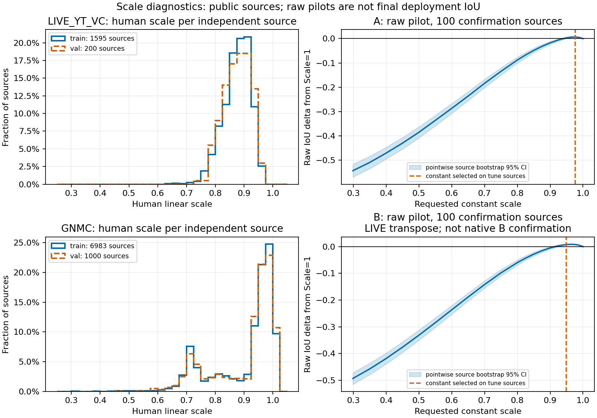

# Scale 是否值得学习：本地 E0/E1/E2 诊断

**结论：暂不启动 Scale-SFT/DPO。真实部署结论仍待冻结 P1 最终中心缓存。**

本轮 GPU 使用 0 秒，没有远程操作，没有模型推理或 SFT/DPO。GNMC 图像描述符和固定 ridge 探针只在 CPU 运行。



## E0：最优常数与 Scale=1.0

正式 A/B 最优常数、真实部署 IoU 和收益目前均为 `null`。本地历史缓存只含单帧中心输出，缺少完整 PTS、主体锚点、轨迹和平滑/QP 输出；不能将下表称为真实部署表现。B 是 LIVE 转置，不能代表原生 B。

| 历史 Raw 几何 pilot | 最优常数 | Scale=1 IoU | 所选常数 IoU | 相对 Scale=1 的源配对 95% CI |
|---|---:|---:|---:|---|
| A | 0.975000 | 0.640086 | 0.646775 | +0.006689 [+0.005453, +0.008078] |
| B | 0.948719 | 0.592526 | 0.600179 | +0.007653 [+0.005542, +0.009916] |

A 为 1,200 帧、B 为 2,000 帧，各 200 独立 LIVE 视频源。每路按预先固定 source 哈希分成 100 tune / 100 confirmation；只在 tune 选择尺度，confirmation 配对 bootstrap 2,000 次。此前项目已使用这些验证源，因此不是新鲜最终留出。全常数表均提供与 Scale=1 的比较；其他格点只是探索性敏感性分析。

真实 QP 代码已按 P1 配置 SHA256 验证：它要求 baseline/candidate 宽度一致，只修改活动轴位置。Scale 保持 Position 冻结的合法接法是在最终 P1 QP 后收缩。QP 前后 P1 尺度在代码上不变；逐源观测仍缺失，不能伪造测量值。最终整数宽度/比例衍生高度单独计量。原有 `integer_predictions()` 强制最大窗口，会抹掉预先插入的 Scale；本诊断使用独立的固定中心 `[x,y,w]` 导出，禁止经过该最大窗重写。

## E1：内容可预测性、风格噪声与中心偏差

输入隔离发现 GNMC 4 组跨 Train/Val 的完全相同图像：隔离训练源 001183、001972、003413、009560，连同转置视图共 8 行；原文件不修改。干净 GNMC Train 6,996 个 ID 合并为 6,983 个独立图像，Val 为 1,000 图像。LIVE 沿用已隔离的 1,595/200 视频源。统计和 bootstrap 均以独立图像/视频为单位，不按帧或候选行抽样。保留原有八动作，不利用 Val 重新拟合；由于历史 bin 拟合已经读过这四组重复图像的训练标签，未来 E0/E2 额外排除 GNMC Val 000667、001961、007010、008745，使用 996 个无此重叠的图像。E1 的清洁 Train 探针仍可用全部 1,000 个独立 Val 图像。

| 人工尺度（source-mean） | Train 均值 / 中位数 | Val 均值 / 中位数 |
|---|---|---|
| LIVE_YT_VC/A | 0.875519 / 0.880219 | 0.876371 / 0.882277 |
| LIVE_YT_VC/B | 0.875520 / 0.880216 | 0.876377 / 0.882315 |
| GNMC/A | 0.905868 / 0.956000 | 0.907082 / 0.955560 |
| GNMC/B | 0.906510 / 0.957091 | 0.907679 / 0.956580 |

人工框的比例误差、尺度超过 1 和越界数量保留在 JSON 中，没有将原始标注偷偷改成合法动作。GNMC A、LIVE B 是同步转置增强。人工平均尺度不能直接作为最佳 IoU 常数。

| GNMC 单帧 CPU 探针 | Val R²（相对 Train 常数） | 几何元数据 R² | 增量视觉 R² [source bootstrap 95% CI] |
|---|---:|---:|---|
| A | 0.1517 | 0.0438 | 0.1079 [0.0705, 0.1444] |
| B | 0.1503 | 0.0421 | 0.1082 [0.0708, 0.1448] |

固定 ridge alpha=10，训练侧标准化、5 折 source 交叉拟合、100 次训练标签置换。特征只读 RGB：亮度、对比度、色差、边缘、熵、频谱显著性面积/连通分量/中心。约 15% 是这个受限探针对 GNMC 人工尺度的源外预测能力，约 11 个百分点是控制图像几何后的增量；不是全部可解释信息的比例，也不是可迁移到 LIVE 的证明。置换 R² 接近零。所有特征和拟合都未使用 Val 标签调参。

**真实主体大小、主体数量、环境占比尚无已验证特征缓存，相关性结果为 null。显著性连通分量不是主体数量。LIVE 的本地帧媒体缺失，视觉解释率为 null。** 每图/帧仅有一个人工框、无逐标注者重复测量，无法识别风格噪声方差；视频内/视频间差异都混有内容和标注因素，不能解释为标注者风格。

**P1 样本内偏差严重程度未知。** 缺实际训练源 P1 输出，训练 JSON 中 `response` 是人工派生标签，绝不能当作 P1 样本内预测。新增缓存入口可分别计算 train/val 中心误差和独立 source bootstrap 的乐观偏差，但这个比较仍可能混有 domain 差异。

中心与尺度的反事实使用双方共同合法动作，避免边界投影暗改中心；只作为分解，GT 中心不进入学习或策略输入：

| 历史 pilot | 活动轴中心绝对误差 / 图像维度 | GT 中心下最佳动作改变比例（source macro） |
|---|---:|---:|
| A | 0.0666 | 16.67% |
| B | 0.0714 | 19.50% |

这说明位置误差会影响最优尺度标签；不能将其统称为 Scale 学不会。±1/3/5% 活动轴中心抖动的标签敏感性已在 JSON 分开记录，这些扰动不改变正式 P1。真正交叉拟合 P1 要按源重训位置模型，本轮不执行；CPU Scale 探针交叉拟合不等于 P1 交叉拟合。抖动增强成本低，但只能在测得源外中心残差后校准，不能修复或证明样本内偏差已消失。

## E2：八动作精确 Oracle

| 历史 Raw pilot | 常数策略 Greedy | Oracle@1 | Oracle@2 | Oracle@4 | Oracle@8 | Oracle@8−最佳常数 [95% CI] |
|---|---:|---:|---:|---:|---:|---|
| A | 0.646344 | 0.646344 | 0.651753 | 0.656354 | 0.671579 | +0.024803 [+0.019893, +0.030297] |
| B | 0.600179 | 0.600179 | 0.605592 | 0.610851 | 0.632282 | +0.032103 [+0.028066, +0.037227] |

Oracle@K 的候选顺序仅由 tune 源上的全局动作得分决定，不按每帧 GT 重排。每个候选都经整数 `[x,y,w]` 与比例衍生高度计算 IoU，按最终框去重；pilot 两路候选重复率均为 0，最大 Position Drift ≤0.5 px。动作分布、GT 中心反事实及抖动敏感性见 JSON。此处 Greedy 是调优后的**常数策略**，学习型模型 Greedy 未提供，保留 null。

Oracle 的约 0.025/0.032 Raw 空间是标签可见条件下的几何上界，不是单帧模型可实现提升，更不是官方 Score。真实部署 Oracle 和相对最佳常数的空间仍为 null。精确八动作只消耗 CPU，不预留 3 小时 GPU。

## 八个问题的当前答案

1. **A/B 最优常数？** 真实部署尚未知；历史 Raw pilot 为 A=0.975、B=0.948719，B 仅为 LIVE 转置。
2. **常数收缩的真实部署增益？** 尚未测得；Raw pilot 为 A +0.006689、B +0.007653 IoU，不能替代部署增益。
3. **人工尺度有多少可由内容解释？** 受限 GNMC 探针有约 0.15 源外 R²，控制几何后约 +0.11；总解释比例、LIVE 比例和标注者风格噪声比例无法识别。
4. **P1 样本内偏差多严重？** 未知，缺真实训练源推理；不能从训练标签推断。
5. **位置误差改变最优 Scale 吗？** 历史 Raw 反事实中 A 约 19.5%、B 约 22.4% 样本的 source-macro 最优动作改变，支持存在耦合；最终部署需复核。
6. **Oracle@K 相对最优常数还有多少空间？** Raw Oracle@8 约 +0.024803/+0.032103；最终部署空间未知，且上界不等于可学习信息。
7. **值得启动 Scale-SFT 吗？** 当前不启动。先补最终 P1 中心，确认最佳常数、原生 B、中心偏差和源外内容策略相对最佳常数的部署收益；GNMC 弱正信号支持继续小成本诊断，不能据此批准 SFT。
8. **GAICD MOS 是否有独立价值？** 有，MOS 测量审美排序，与单框 IoU 监督不同；但当前固定中心、精确画幅 Scale 可用覆盖很小，不能直接推导 DPO 有益。

GAICD 只打开 Journal Train 标注：A/B 有效目标比例候选 54/2,082，至少两个候选的图像 6/192；同图同中心（≤1 px）、不同尺度的候选对仅 3/107，尚未按 P1 中心和八动作过滤，也未筛选 MOS 差值。这些是几何支持计数，不是 DPO 偏好数据量，未生成偏好文件。

## 后续输入、复现与停止点

运行命令、环境、输入/代码 SHA、Git 状态摘要见 `execution.json`；统计方案见 `protocol.json`；原始常数全表、source 划分和 source-bootstrap 区间见三个 JSON。缓存及干净 public manifest 保留本地且不入 Git。

```bash
CUDA_VISIBLE_DEVICES='' OPENBLAS_NUM_THREADS=1 python -m scripts.run_scale_diagnostics
# 取得身份绑定且覆盖完整 source/view 的最终 P1 缓存后，仅运行 CPU：
CUDA_VISIBLE_DEVICES='' OPENBLAS_NUM_THREADS=1 python -m scripts.run_scale_diagnostics --positions PATH_TO_PUBLIC_P1_POSITIONS_JSONL
```

缓存要求、已有 GPU 程序的使用边界和待批准推理预算见 `pending_inference_plan.json`。本轮不运行该程序，不调用远程 GPU，不自动开始后续阶段。
