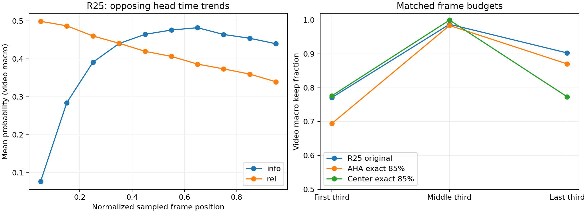

# R26 选帧、预算、公共位置与空间对照（2026-10-16）

AutoDL恢复后执行。复用R25全部426份原始评分，逐视频重建选择掩码与原ZIP一致；没有重算官方测试视频、训练或读取测试GT。公共26TRAIN/14DEV独立跑冻结AHA，预留14源未打开。这里只比较当前复赛观测，初赛分不参与。

## 官方回分更新（2026-10-16）

**中心85+B3=36.04（新最佳）；精确AHA=35.07；R25固定mask中心空间=30.23。** 用户报告，本地ZIP SHA已重核，上传字节未独立核验。中心时间对照高0.97，预算修正低0.11，B3空间高4.95；因果边界与下一轮见[official_analysis.md](official_analysis.md)。下文公共诊断及构建过程保留。

## 已确认的问题

**预算实现偏差已确认**：R25标称85%，实际204,907/234,159=87.5076%，逐视频宏平均88.7453%。精确round(.85*N)应为199,037帧，超额5,870；每视频超额中位13.5、最大50帧。新精确包只截断最后一个入选时间cell，所有199,037个保留框与B3一致。官方回分显示精确预算35.07比原35.18低0.11，不能把原0.34分差归因于预算偏差。

**评分有可测的相反时间趋势**：426视频中，info与时间Spearman中位+0.63462，rel为−0.82667，sum为+0.28528；info/rel相关性中位−0.37088。第一帧sum相对其余帧均值，视频平均低0.33983。info视频内std中位0.15535，rel中位0.06579，等权相加并不是等幅贡献。sum唯一分数比例视频均值99.985%，不是大量同分导致；rel落在<.01或>.99的比例为0，不支持rel饱和解释。不同时间bin所含视频数不同，曲线仅描述分布，不能当作严格因果效应。

R25首采样点仅28/426入选，297视频只有一个连续区间。精确预算后前/中/后三分之一保留率为69.45%/98.41%/87.06%，预算修复未消除删头倾向。截断规则可能将原连续区间切成多个区间，所以新包连续段数改变是预注册后处理的结果，不能解释成内容理解变强。

## 固定协议训练源探针

同一个TRAIN视频前16帧对比chunk8与chunk1；另把第一帧重复16次、反转前16帧。完整数值保存在train_protocol_probe.json。重复帧分数变化可以证明上下文影响，不能证明该变化在比赛中错误；单源探针也不能推断426视频的成因比例。R25第一块native数值一致不代表分块大小不影响BF16数值。

## 官方对照包

三个包均426/426视频，双validator通过，ZIP根目录只有predictions.jsonl；参数均≤9B。**三包已由用户回报官方分（36.04/35.07/30.23）；未由Agent上传。**

| 包 | 预测帧数 | 唯一主要改变 | 总推理参数 |
|---|---:|---|---:|
| R26_AHA_EXACT085_B3 | 199037 | 相对R25，消除整cell预算超额 | 8,480,646,545 |
| R26_POS_CENTER_EXACT085_B3 | 199037 | 相对精确AHA，改用中心连续时间窗口；框相同 | 450,283,377 |
| R26_R25MASK_CENTER | 204907 | 相对原R25，帧号完全相同，只换最大合法中心框 | 8,030,363,168 |

空间包116,620/204,907个框发生变化，保持原帧顺序/数量；其余88,287框本已居中。没有空间GT，合法中心窗不能被预先判为更优。位置控制不再运行AHA、中心空间控制不再运行B3，因此如实声明不同参数量；当前项目记录复赛回分不乘k_size；参数仍须如实申报，不能虚报同参数。

构建时建议（现已回分）：精确预算包（与35.18原R25比较）→固定R25掩码中心空间包（仍与35.18比较）→中心时间控制（与精确预算AHA比较）。不要把中心空间包与精确预算包作单因素比较，因为两者同时改变时间与空间。

- `R26_AHA_EXACT085_B3` ZIP SHA256：`d740b68dcafea20ecda4cb125f1754062798e576d6956a95e8c3e9ff17c63ffc`
- `R26_POS_CENTER_EXACT085_B3` ZIP SHA256：`95d079da9b1f845e967509dcb5a3bebc057e8501b582cdc4858af4fc7b60a981`
- `R26_R25MASK_CENTER` ZIP SHA256：`c2ba52a6d6fea532eff53bc5c68b4c63058b86c7949a548ab0d05ca461d68f2d`

具体本地ZIP路径在`submissions/R26_DIAG/<包名>/<包名>.zip`。原始测试评分、逐视频预测及ZIP保持ignored；Git只保存汇总、配置、脚本。复现命令与环境边界见[reproduce.md](reproduce.md)。

## 公共26TRAIN/14DEV实测（时间F1，非官方Score）

冻结R25协议，40/40视频评分完成，用时488.76秒，峰值allocated17,860,467,712B（约16.64GiB）。26TRAIN仅用于位置三次回归；14DEV一次汇总预注册臂；预留14未读取。媒体和轴SHA逐源核验，采样帧号和实际PTS见bindings.json。全帧F1=0.2925704226863064，与R24同轴基准一致。

| 方法 | 精确keep .85 | .60（次要） | .25（次要） |
|---|---:|---:|---:|
| aha_sum | 0.290883 | 0.279595 | 0.255432 |
| aha_info | 0.284201 | 0.260469 | 0.200378 |
| aha_rel | 0.291217 | 0.292486 | 0.275960 |
| position_prefix | 0.297467 | 0.309137 | 0.264970 |
| position_suffix | 0.264624 | 0.220298 | 0.163883 |
| position_center | 0.288381 | 0.243143 | 0.195820 |
| position_train_cubic | 0.297467 | 0.309137 | 0.264970 |
| fixed32_random | 0.285110 | 0.265662 | 0.202117 |
| select_all | 0.292570 | 0.292570 | 0.292570 |
| aha_sum_wholecell | 0.292592 | 0.279788 | 0.256773 |

除select_all/aha_sum_wholecell外，各臂逐视频预算严格一致；wholecell是R25历史超额规则，不能当作等预算臂。

主要预算.85的配对源bootstrap（14源，10000次，95%CI）：

- AHA sum − position_prefix：-0.006584，CI [-0.017518, +0.003873]。
- AHA sum − position_center：+0.002502，CI [-0.014918, +0.019893]。
- AHA sum − fixed32_random：+0.005773，CI [-0.010906, +0.020509]。
- AHA sum − aha_info：+0.006683，CI [-0.004880, +0.017150]。
- AHA sum − aha_rel：-0.000334，CI [-0.007662, +0.006898]。
- AHA sum − aha_sum_wholecell：-0.001708，CI [-0.004642, +0.000437]。

**结论：冻结generic query、full-history、1:1双头的AHA，在这个公共开发协议下未证明优于中心、前缀/训练位置回归或随机控制。** 对suffix的配对CI为正，但suffix本身很弱，不能据此声称内容能力已过门。两头在.85下相互比较也未显示可靠差异；不能因为次要预算rel数值较高就直接切换比赛方案。多重探索比较未校正，14源CI较宽，DEV在R24已观察过，不是fresh holdout，也不能将公共F1映射成复赛分。

在公共DEV中，精确预算sum比wholecell低0.001708，CI跨零；因此“修复预算一定提高分数”不成立。修复的价值首先是公平、可解释的预算对照，官方精确预算比整cell低0.11，与“修复必然提高”不符。

TRAIN静态探针：同图重复16次，sum首0.356248、末0.446734、range0.107329，证实固定内容下仍有因果上下文响应。chunk8对chunk1的sum最大差0.017685，全部头最大差0.046875（包括uncertainty）；首块native一致检查仍然全部通过。不能把数值局部一致扩展成chunk不变，也不能把单源上下文响应当作所有视频删头错误的证明。

## 决策与剩余阻塞

1. SSH阻塞解除，raw分布/预算和公共位置对照已完成；没有证据归咎参数容量、文件字节大小或分数天花板。
2. 中心85+B3以36.04晋级最佳；历史35.52保留。AHA精确35.07、R25为35.18，均不晋级；generic-query双头配方不直接用于大规模蒸馏或扩模型。
3. 三个官方回分已记录。固定mask中心窗低4.95，保留B3；不能由此声称空间已解决。后续R27固定B3对照预算和位置，详见official_analysis.md。
4. 官方对照后，优先在TRAIN上评估“按时间去趋势/校准双头”“有限窗口与full-history”“query/文本顺序”单变量对照，再按预注册方式验证，避免DEV选配方后反复宣称独立成功。

完整数值：diagnostics.json、public_metrics.json；模型/脚本SHA、运行边界与复现命令见code_identity.json、reproduce.md及AutoDL隔离目录。R26分数事件见official_score_events.json；后续R27官方分仍null，未自动上传平台。
